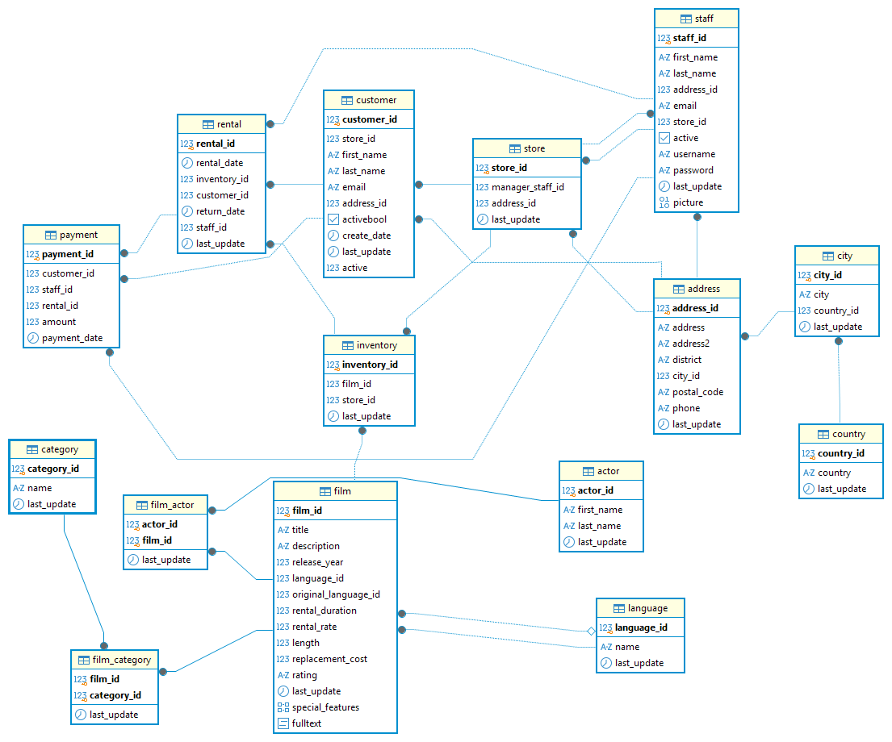

# Proyecto SQL: consultas sobre la base de datos Sakila

Proyecto del módulo de SQL. La base de datos es la de una tienda ficticia de alquiler de películas (Sakila) y el objetivo era resolver 64 consultas sobre ella con PostgreSQL y DBeaver.

## Qué hay en este repositorio

| Archivo | Contenido |
|---|---|
| `consultas_sakila.sql` | Las 64 consultas resueltas. Cada una lleva su número, el enunciado como comentario y debajo un comentario con el resultado. |
| `esquema_sakila.png` | El esquema de la base de datos (consulta 1), sacado con DBeaver. |
| `README.md` | Este archivo: los pasos que he seguido y el informe del análisis. |

## Herramientas

- PostgreSQL 16
- DBeaver

## Pasos que he seguido

**1. Cargar la base de datos.** Creé una base de datos nueva llamada `sakila` en DBeaver y ejecuté el script `BBDD_Proyecto_shakila_sinuser.sql`. La primera vez DBeaver dio un error interno porque intentaba mostrar el resultado de cada uno de los miles de `INSERT`. Lo volví a lanzar desactivando la visualización de resultados y omitiendo los errores de "ya existe" de lo que se había cargado la primera vez. Para comprobar que estaba todo, conté las filas de las tablas principales: 1000 películas, 200 actores, 16.044 alquileres y 16.049 pagos.

**2. Entender la base de datos.** Antes de empezar con las consultas miré las tablas en la pestaña *Datos* de DBeaver para ver qué columnas tenía cada una y qué tipo de datos guardaban.

**3. Sacar el esquema.** Con *Ver diagrama* sobre el esquema `public` saqué el diagrama de las 15 tablas y sus relaciones y lo exporté como imagen.

Las relaciones que más he usado:

- `film` ↔ `film_actor` ↔ `actor`: qué actores salen en cada película.
- `film` ↔ `film_category` ↔ `category`: a qué categoría pertenece cada película.
- `film` ↔ `inventory` ↔ `rental`: las copias de cada película y sus alquileres. Un alquiler no apunta directamente a una película, sino a una copia del inventario.
- `rental` ↔ `customer` / `payment`: quién alquila y cuánto paga.

**4. Resolver las consultas.** Las hice en orden. Las primeras son de una sola tabla (`WHERE`, `ORDER BY`, `GROUP BY`, funciones como `COUNT`, `AVG`, `SUM`...). Después vienen las de varias tablas con `JOIN`, `LEFT JOIN`, `FULL JOIN` y `CROSS JOIN`, luego las subconsultas y al final la vista y las tablas temporales. En algunas he puesto una segunda versión (por ejemplo, la 4.1 o la 6.2) para enseñar otra forma de llegar al mismo resultado.

**5. Comprobar los resultados.** Después de cada consulta miré si el resultado tenía sentido y lo apunté en un comentario. Cuando se podía, lo comprobé cruzándolo con otra consulta. Por ejemplo, en la 8 las 253 películas salen de 223 PG-13 + 39 de más de 3 horas − 9 que cumplen las dos condiciones.

## Informe del análisis

### El catálogo

- Hay **1000 películas** y todas son de **2006**.
- Las clasificaciones por edades están bastante repartidas: PG-13 es la más frecuente (223) y G la menos (178).
- La duración va de **46 a 185 minutos**, con una media de unos 115 minutos. Por clasificación apenas cambia: todas rondan las dos horas.
- Solo hay **tres precios de alquiler**: 0,99 €, 2,99 € y 4,99 €. Como la media es 2,98 €, "por encima del precio medio" son todas las de 2,99 € y 4,99 € (659 películas).
- El coste de reponer una película ronda los 20 €, con una desviación estándar de unos 6 €.
- Por categorías, Sports es la que más películas tiene (74) y Music la que menos (51).

### Los alquileres y el dinero

- La empresa ha ingresado en total **67.416,51 €**, con un pago medio de 4,20 €.
- **Julio de 2005** es el mes con más alquileres (6.709) y el día con más alquileres es el **31 de julio de 2005** (679).
- La categoría más alquilada es **Sports** (1.179 alquileres) y la que menos, **Music** (830). Coincide con que también son la categoría con más y con menos películas.
- El cliente que más ha gastado es **KARL SEAL** (221,55 €), pero quien más veces ha alquilado es **ELEANOR HUNT** (46 alquileres). Alquilar más veces no significa siempre gastar más, porque depende del precio de cada película.
- Todos los clientes han alquilado algo: el que menos, 12 veces.

### Los actores

- Hay **200 actores**. Quien más películas tiene es **GINA DEGENERES** (42), y el que menos tiene 14, así que no hay ningún actor sin películas.
- Hay nombres repetidos. Por ejemplo, hay dos actores que se llaman **SUSAN DAVIS** (son personas distintas, con distinto id). Por eso, cuando agrupo por actor, lo hago por su id y no solo por el nombre.

### Cosas raras en los datos

Algunos resultados al principio parecían errores, pero eran cosas de los datos:

- **`original_language_id` está vacío (NULL) en todas las películas.** Por eso la consulta 4 (películas cuyo idioma coincide con el original) devuelve 0 filas.
- **Los nombres, apellidos y títulos están en mayúsculas** ('ALLEN', 'JOHNNY', 'EGG IGBY'), aunque el enunciado los escribe con minúsculas. Con `=` o `LIKE` hay que escribirlos igual que están guardados; si no, se puede usar `ILIKE`.
- **No hay datos de septiembre de 2005 a enero de 2006**, y en febrero de 2006 hay 182 alquileres que tienen todos exactamente la misma fecha y hora (14/02/2006 15:16:03). Parecen datos cargados de golpe más que alquileres reales.
- **42 películas no tienen ninguna copia en el inventario** y **3 películas no tienen ningún actor** (DRUMLINE CYCLONE, FLIGHT LIES y SLACKER LIAISONS).

## Lo que he aprendido

- La diferencia entre `WHERE` (filtra filas antes de agrupar) y `HAVING` (filtra grupos después de agrupar).
- Cuándo usar `JOIN` y cuándo `LEFT JOIN`: si el enunciado dice "incluso si no tienen...", hace falta `LEFT JOIN` para no perder filas.
- Que `NULL` no se compara con `=`, sino con `IS NULL`.
- Que cuando hay empates conviene ordenar también por una segunda columna, para que el resultado salga siempre igual.
- Que un resultado vacío o "raro" no siempre es un error de la consulta. Hay que mirar los datos para entender por qué sale así.

## Cómo ejecutar las consultas

1. Crear una base de datos en PostgreSQL y cargar `BBDD_Proyecto_shakila_sinuser.sql`.
2. Abrir `consultas_sakila.sql` en DBeaver conectado a esa base de datos.
3. Ejecutar cada consulta con el cursor dentro (Ctrl+Enter). En la 48, la 51 y la 52 hay que ejecutar las sentencias en orden, porque primero se crea la vista o la tabla temporal y después se consulta.
